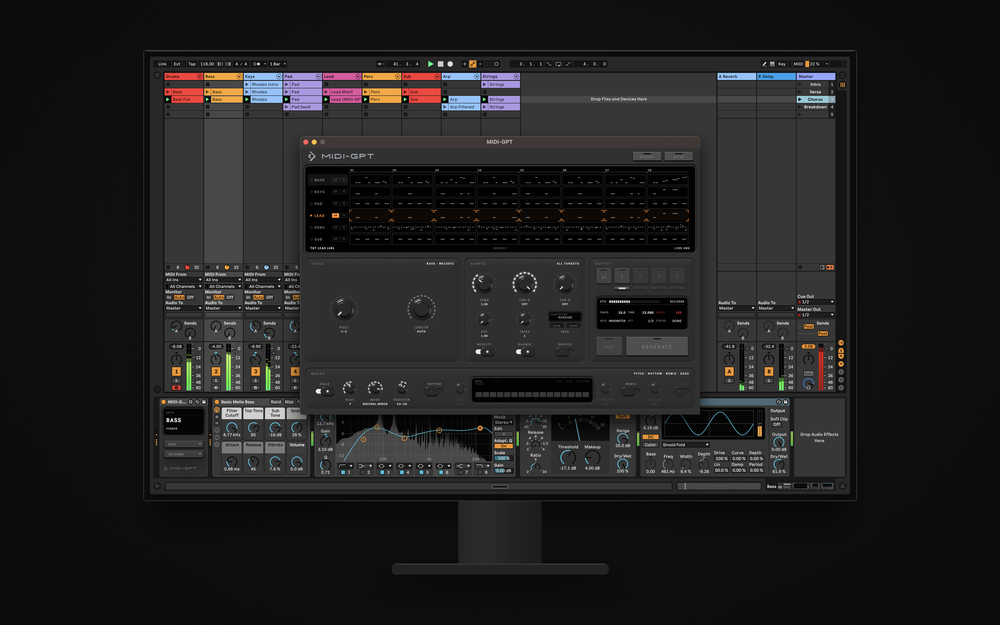

[](https://metacreation.net/category/projects/)

[](#reporting-bugs)
[](LICENSE)
[](https://www.ableton.com/live/)
[](https://www.ableton.com/live/max-for-live/)
[](https://www.python.org/)
[](https://github.com/Metacreation-Lab/MIDI-GPT)
[](https://arxiv.org/abs/2501.17011)
[](https://huggingface.co/Metacreation/MIDI-GPT)

<p align="center"></p>

**MIDI-GPT for Live** is a Max for Live device that writes MIDI into your Ableton Live clips with [MIDI-GPT](https://github.com/Metacreation-Lab/MIDI-GPT), a transformer for computer-assisted multitrack composition. It reads every MIDI clip in the selected scene as context, generates the bars you choose, and writes the result back into the clips as takes you can audition, revert or keep.

- **Fill in bars**: paint the bars to rewrite on any track; the rest of the scene stays as it is and is used as context.
- **Continue or create tracks**: turn on **AR** to generate a whole track, including one that has no clip yet.
- **Steer the output**: polyphony, note length, density, scale, register, rhythm and remix per track; temperature, top-p and top-k for the whole request.
- **Takes**: generate up to 16 versions at once, step through them in place, go back to the original, or keep one.
- **Runs on your computer**: the model runs in a local server; nothing leaves your machine unless you point the device at a server elsewhere.

> [!WARNING]
> **MIDI-GPT for Live is in beta.** It works, but it hasn't been used on many machines or sets yet, and some combinations of settings still go wrong. Please [report what you find](#reporting-bugs): small things too.

**Trailer:** [watch on YouTube](https://youtu.be/t7Ze_Log_5Q) (1:39).

**Documentation:** [metacreation-lab.github.io/midigpt-LIVE](https://metacreation-lab.github.io/midigpt-LIVE/): install, a tour of every control, workflows and troubleshooting.

Companion project: [MIDI-GPT for REAPER](https://github.com/Metacreation-Lab/midigpt-REAPER).

## Table of Contents

- [Installation](#installation)
  - [Requirements](#requirements)
  - [One-Line Install](#one-line-install)
  - [Manual Install](#manual-install)
  - [Hugging Face Access](#hugging-face-access)
  - [macOS Quarantine](#macos-quarantine)
  - [Updating / Uninstalling](#updating--uninstalling)
- [How It Works](#how-it-works)
- [Usage](#usage)
  - [Quick Start](#quick-start)
  - [Choosing What to Generate](#choosing-what-to-generate)
  - [Takes](#takes)
  - [Track Instruments](#track-instruments)
  - [Remote Server](#remote-server)
- [Controls](#controls)
- [Tips & Common Gotchas](#tips--common-gotchas)
- [Troubleshooting](#troubleshooting)
- [Reporting Bugs](#reporting-bugs)
- [Contribution](#contribution)
- [Citing](#citing)
- [Acknowledgments](#acknowledgments)
- [License](#license)

---

## Installation

### Requirements

| | |
|---|---|
| **Ableton Live** | 11 or 12: Suite, or Standard with the Max for Live add-on |
| **Max** | the Max bundled with Live: 8.6 (Live 11 to 12.1) or 9 (Live 12.2 and later) |
| **OS** | macOS, Windows or Linux (tested on macOS; the Windows and Linux installers are untested) |
| **Server** | Python 3.10–3.14 (3.10–3.12 on Intel Macs) and [`midigpt`](https://pypi.org/project/midigpt/) 0.4.2; the installer sets these up |
| **Hugging Face** | a free account that has accepted the [model license](https://huggingface.co/Metacreation/MIDI-GPT), and an access token: see [Hugging Face Access](#hugging-face-access) |
| **Disk** | about 1 GB for the server environment, plus the model: 83 MB (`yellow_small`) or 350 MB (`yellow_medium`) |
| **Hardware** | any recent computer; no GPU needed (an NVIDIA GPU is used when there is one) |

### One-Line Install

macOS and Linux, in Terminal:

```bash
curl -fsSL https://metacreation.net/midigpt-live/bootstrap.sh | bash
```

Windows, in PowerShell:

```powershell
irm https://metacreation.net/midigpt-live/bootstrap.ps1 | iex
```

This downloads the latest release and copies the **MIDI-GPT** folder into your Live User Library (the location is read from Live's preferences). It then asks whether to set up a server on this computer: a Python environment with `midigpt` (in `~/Library/Application Support/MIDI-GPT/server`, `~/.config/MIDI-GPT/server` on Linux, `%APPDATA%\MIDI-GPT\server` on Windows), a **Start MIDI-GPT Server** launcher (Desktop and Start menu shortcuts on Windows), and the model. On Windows it also offers Microsoft's Visual C++ runtime, which PyTorch needs, and the CUDA build of PyTorch when there is an NVIDIA GPU. If no Hugging Face token is saved yet, it asks for one (see [Hugging Face Access](#hugging-face-access)). Skip the server if yours runs on another machine.

Options go after `bash -s --`, for example `curl -fsSL …/bootstrap.sh | bash -s -- --no-server`:

| Flag | |
|---|---|
| `--no-server` / `--server` | install only the devices, or set up the server without asking |
| `--model yellow_small` | the smaller, faster model (default `yellow_medium`) |
| `--user-library DIR` | install the devices into another User Library |
| `--zip FILE` | install from a downloaded release zip |
| `--yes` | accept every default (a Hugging Face token is then read from `HF_TOKEN`) |
| `--uninstall` | remove everything (see below) |

On Windows the options are PowerShell flags, passed through a script block, for example
`& ([scriptblock]::Create((irm https://metacreation.net/midigpt-live/bootstrap.ps1))) -NoServer`: `-NoServer` / `-Server`, `-Model`, `-UserLibrary`, `-Zip`, `-Gpu` / `-Cpu` (the PyTorch build), `-Yes`, `-Uninstall`.

### Manual Install

1. **The device.** Download `MIDI-GPT-for-Live-<version>.zip` from the [latest release](https://github.com/Metacreation-Lab/midigpt-LIVE/releases/latest), unzip it, and move the `MIDI-GPT` folder into your User Library (by default `~/Music/Ableton/User Library`). Keep its contents together:

   | file | |
   |---|---|
   | `MIDI-GPT.amxd` | the device you use |
   | `MIDI-GPT Instrument.amxd` | a small tag MIDI-GPT adds to each track to remember its instrument; you never add it yourself |
   | `Server/` | the server launchers: **Start MIDI-GPT Server.command** (macOS), **.bat** (Windows), `start-server.sh` (Linux) |

2. **A Python environment** with Python 3.10–3.14 (3.10–3.12 on an Intel Mac), in the server folder the launchers look in:

   | OS | server folder |
   |---|---|
   | macOS | `~/Library/Application Support/MIDI-GPT/server` |
   | Linux | `~/.config/MIDI-GPT/server` |
   | Windows | `%APPDATA%\MIDI-GPT\server` |

   ```bash
   python3.12 -m venv ~/Library/Application\ Support/MIDI-GPT/server/.venv     # Windows: py -3.12 -m venv "%APPDATA%\MIDI-GPT\server\.venv"
   source ~/Library/Application\ Support/MIDI-GPT/server/.venv/bin/activate    # Windows: "%APPDATA%\MIDI-GPT\server\.venv\Scripts\activate"
   ```

3. **MIDI-GPT:**

   ```bash
   pip install "midigpt[http,inference]==0.4.2"
   ```

   On an Intel Mac, add `"torch<2.3" "numpy<2"` (the last PyTorch built for Intel Macs).

4. **Sign in to Hugging Face** with your token (see [Hugging Face Access](#hugging-face-access)):

   ```bash
   hf auth login
   ```

5. **Start the server** from the `Server` folder inside `MIDI-GPT`: double-click **Start MIDI-GPT Server.command** (macOS)
   or **Start MIDI-GPT Server.bat** (Windows), or run `start-server.sh` (Linux). The first start downloads the model.
   Leave the window open while you work; Ctrl+C stops the server. To use another model or port, put `MODEL=yellow_small`
   or `PORT=3457` lines in a `server.conf` file in the server folder.

   The server uses the GPU when there is one (CUDA, or MPS on a Mac). **On a Mac, MPS can be slower than the CPU** for a model this size (twice as slow on an Intel Mac with a Radeon GPU): if generations are slow, start it with `start-server.sh --device cpu`.

### Hugging Face Access

The models are downloaded from [Metacreation/MIDI-GPT](https://huggingface.co/Metacreation/MIDI-GPT) on Hugging Face, which needs a free account:

1. Sign in at [huggingface.co](https://huggingface.co) and accept the license on the [model page](https://huggingface.co/Metacreation/MIDI-GPT).
2. Create an access token in **Settings › Access Tokens** ([huggingface.co/settings/tokens](https://huggingface.co/settings/tokens)); the **Read** type is enough.
3. Give it to the installer when it asks, or run `hf auth login` in the server's environment. The token is saved in `~/.cache/huggingface/token`, where the server finds it on every start. Setting `HF_TOKEN` works too.

The token is only used by the server, to download the model; the device never sees it. A model that is already downloaded keeps working without one. If the server can't get the model, its window says why and stays open.

### macOS Quarantine

macOS quarantines files downloaded with a browser. If Live won't load the device, or the launcher won't open, clear the flag (the one-line installer does this for you):

```bash
xattr -dr com.apple.quarantine ~/Music/Ableton/User\ Library/MIDI-GPT
```

### Updating / Uninstalling

Run the one-line install again to update: it replaces the devices and keeps your settings and server. To remove everything:

```bash
curl -fsSL https://metacreation.net/midigpt-live/bootstrap.sh | bash -s -- --uninstall
```

On Windows, in PowerShell:

```powershell
& ([scriptblock]::Create((irm https://metacreation.net/midigpt-live/bootstrap.ps1))) -Uninstall
```

This removes the MIDI-GPT folder from the User Library, the server environment, the launchers and the settings. Downloaded models stay in `~/.cache/huggingface` (delete `models--Metacreation--MIDI-GPT` there to free the space), and so does the Hugging Face token (`hf auth logout` removes it).

---

## How It Works

```
 Live set ─── clips in the selected scene ───▶ MIDI-GPT.amxd ─── HTTP ───▶ midigpt-http (127.0.0.1:3456)
    ▲                                               │                           │  the MIDI-GPT model
    └─────────── generated bars, as takes ◀─────────┘ ◀──────── score ──────────┘
```

The device sends the scene to the server as a score, with what to generate and how. The server runs MIDI-GPT and returns the result, which the device writes into only the bars you asked for. The server is the HTTP server from the `midigpt` Python package ([API reference](https://metacreation-lab.github.io/MIDI-GPT/)). The device keeps the server address in `~/Library/Application Support/MIDI-GPT/live.json`.

---

## Usage

### Quick Start

1. Start the server: **Start MIDI-GPT Server** on the Desktop or in the MIDI-GPT folder's `Server` folder (step 5 above). On the device's **SETUP** page, the light next to the address turns green when the server is reachable.
2. In Live's browser, open **User Library › MIDI-GPT** and drag **MIDI-GPT** onto any track. Click the key on the device to open its window.
3. Run **SETUP › SETUP ALL** once per set: MIDI-GPT guesses each track's instrument from its device and name, lets you confirm each guess, and writes a small **MIDI-GPT Instrument** tag onto each track.
4. Select a scene with some MIDI clips. In the roll at the top of the window, paint the bars to generate on a track, or turn on **AR** for the whole track.
5. Press **GENERATE**. Step through the takes, then press **KEEP**.

### Choosing What to Generate

The roll shows every MIDI track of the selected scene. A track is generated when you paint some of its bars or turn on **AR**; every other track is context. Mark a track **ignore** to leave it out entirely. A track with no clip in the scene gets one when it is generated. All clips in the scene must share one time signature.

### Takes

Set **TAKES** above 1 to get several versions from one request. The **OUTPUT** section lists them: click a take to write it into the clips, or the ↩ key to hear what was there before. **KEEP** commits the take you are on. The takes stay while you work elsewhere in Live, and always go into the clips they were generated for.

### Track Instruments

MIDI-GPT needs to know what each track plays: a General MIDI instrument, or drums. That is stored on the track itself, in the **MIDI-GPT Instrument** tag, so it survives renaming, moving and duplicating tracks, and is saved with the set. Change it from the tag's **FAMILY** and **PROGRAM** menus or from **SETUP**. A track without a tag is guessed from its instrument (a Drum Rack means drums), then from its name, else piano.

The device does not play anything: your tracks keep their own instruments and sounds.

### Remote Server

The server can run on another computer, such as a studio machine with more power. Start it there with `--host 0.0.0.0` (`start-server.sh --host 0.0.0.0`) so other machines can reach it, then enter its address (for example `http://192.168.1.20:3456`) on the device's **SETUP** page with **EDIT**. The address is remembered for every set.

---

## Controls

**TRACK**, for the selected track. Each knob has an **AUTO** setting that leaves it to the model.

| Control | What it does |
|---|---|
| **POLY** | how many notes sound at once (melodic tracks) |
| **LENGTH** | the range of note lengths, from 32nd to whole notes (melodic tracks) |
| **DENSITY** | how busy the part is (drum tracks) |
| **KEY · RANGE · SILENCE · PCS** | prism and expressive: key, pitch range, silent share of each bar, pitch classes per bar |
| **EXPRESSIVENESS** | expressive: how loosely the notes sit on the beat, from on the grid to freely timed |
| **GENRE** | prism and expressive: the style to write in, for the whole request; click for the list, or ◀ ▶ |

**SAMPLE**, for the whole request.

| Control | Range (default) | What it does |
|---|---|---|
| **TEMP** | 0.1–3 (1) | randomness: lower is safer and more repetitive, higher is more adventurous |
| **TOP-P** | 0.05–1 (off) | sample only from the most likely choices that add up to this probability |
| **TOP-K** | 0–500 (off) | sample only from the K most likely choices |
| **ESC** | 1–3 (1) | raise the temperature on each retry after a rejected result |
| **TAKES** | 1–16 (1) | how many versions to generate |
| **PROB** | 5–100 % (ALL) | regenerate only this share of the painted bars, picked at random |
| **SEED** | 1–2147483647 (random) | click the screen to type one; **DICE** picks a random seed, **LOCK** keeps the last run's (or the selected take's). A fixed seed repeats a result exactly. |
| **NOVELTY · SILENCE · SHUFFLE** | on / off | reject copies of the context, reject empty bars, vary the order tracks are generated in |

**MASKS**, for the selected track.

| Control | What it does |
|---|---|
| **SCALE** · ROOT · MODE · REGISTER | keep notes in a key and between two pitches |
| **RHYTHM** · UNIT · GRID / EXACT | guide onsets toward a grid, or place them exactly where you draw them |
| **REMIX** · AMOUNT · P+D | vary the existing notes instead of writing new ones: AMOUNT is the share of the notes that change (at least one), pitch only or pitch and duration |

The **ENGINE** page holds the model choice; **CONTEXT** (how many bars the model sees at once); **BARS/STEP** and **TRK/STEP** (how much is generated per step); **ATTEMPTS**; polyphony and density hard limits; **MASK P / K**; and **VELOCITY** and **MICRO**timing when the model supports them.

When a request fails, the readout under the takes says what went wrong and what to change.

---

## Tips & Common Gotchas

- **DENSITY** only applies to drum tracks; **POLY** and **LENGTH** only to melodic tracks.
- **REGISTER** only applies with **SCALE** on.
- **REMIX** replaces the rhythm settings on the same track. **POLY LIM** and **DENS LIM** win over it: a wider chord or a fuller bar comes back with fewer notes.
- The scene needs at least **CONTEXT** bars; lower it for short clips.
- The first generation after the server starts is slower while the model loads.
- On older computers, `yellow_small` is noticeably faster.

## Troubleshooting

| Symptom | Fix |
|---|---|
| **NO LINK** in the readout, red light in **SETUP** | the server isn't running or the address is wrong: start it, or check the address. If it stopped at startup, its window says why |
| The server window says the model is gated | accept the license at [huggingface.co/Metacreation/MIDI-GPT](https://huggingface.co/Metacreation/MIDI-GPT) and save a token: see [Hugging Face Access](#hugging-face-access) |
| Generation is slow on a Mac | the GPU (MPS) can be slower than the CPU: start the server with `start-server.sh --device cpu` |
| Windows: the server stops with a DLL error (`WinError 126`, `c10.dll`) | PyTorch needs Microsoft's Visual C++ runtime: install [vc_redist.x64.exe](https://aka.ms/vc14/vc_redist.x64.exe) |
| Windows: "Windows protected your PC" when starting the server | click **More info › Run anyway**, or right-click the `.bat` › Properties › **Unblock** (the installer unblocks the files itself) |
| Port 3456 already in use | another MIDI-GPT server (MIDI-GPT for REAPER uses the same port) is already running: use it, or start this one with `--port 3457` and change the address |
| **TAG FAILED** | Live didn't load the tag device: drag **MIDI-GPT Instrument** from the MIDI-GPT folder onto the track |
| **TIME SIG** | the scene's clips use different time signatures |
| **TOO FEW BARS** | the scene is shorter than **CONTEXT**: lower it or lengthen the clips |
| The device won't load after a download | see [macOS Quarantine](#macos-quarantine) |

Settings: `~/Library/Application Support/MIDI-GPT/live.json`. Server: `~/Library/Application Support/MIDI-GPT/server` (its window shows the log). Models and the Hugging Face token: `~/.cache/huggingface`.

## Reporting Bugs

MIDI-GPT for Live is in beta, so reports are the most useful thing you can send. [Open a bug report](https://github.com/Metacreation-Lab/midigpt-LIVE/issues/new?template=bug_report.yml): the form asks for what you did, what the **OUTPUT** screen said, the settings involved, the lines around the error in the server window, and your versions. [Reporting bugs](https://metacreation-lab.github.io/midigpt-LIVE/reporting-bugs/) says where to find each of them.

When a generation fails, the server saves the request it got to `failed_requests.jsonl` in its folder (`~/Library/Application Support/MIDI-GPT/server` on macOS, `~/.config/MIDI-GPT/server` on Linux, `%APPDATA%\MIDI-GPT\server` on Windows). Attaching it lets the failure be replayed exactly, but it contains the MIDI of your clips: only attach it if you're happy to share that.

---

## Contribution

The devices are built from the sources in this repository; [CLAUDE.md](CLAUDE.md) describes the architecture, the dev bridge and the tools.

```
patchers/        MIDI-GPT.amxd and MIDI-GPT Instrument.amxd (built by the scripts below)
javascript/      midigpt.js (Live API, state, HTTP client) and the panel, strip, tag and Node helper scripts
media/panel/     the panel's images, rendered in Blender
tools/           build, release, freezing, asset and dev scripts
install.sh       the installer for macOS and Linux (bootstrap.sh downloads and runs it)
install.ps1      the installer for Windows (bootstrap.ps1 downloads and runs it)
server/          the server launchers, shipped as MIDI-GPT/Server: start-server.sh, Start MIDI-GPT Server.command / .bat
```

```bash
python3 tools/build_device.py           # patchers/MIDI-GPT.amxd: panel window, strip key, dependencies (in place)
python3 tools/build_tag_device.py       # patchers/MIDI-GPT Instrument.amxd
python3 tools/export_panel_assets.py    # javascript/midigpt_panel_spec.js (and lo-fi panel images: see CLAUDE.md, Panel assets)
python3 tools/build_release.py          # dist/MIDI-GPT-for-Live-<VERSION>.zip, both devices frozen
```

`build_release.py` freezes the devices itself (`tools/amxd_freeze.py`, the same format as Max's **Freeze Device**), so a release needs no Max. Attach the zip to a GitHub release tagged `v<VERSION>`; the installer downloads the newest one. Device conventions follow Ableton's [Max for Live production guidelines](https://github.com/Ableton/maxdevtools/blob/main/m4l-production-guidelines/m4l-production-guidelines.md).

Issues and pull requests are welcome ([reporting bugs](#reporting-bugs)). Known gaps: a MIDI-mappable Generate control, and testing on Windows and Linux.

## Citing

If you use MIDI-GPT in your work, please cite the paper:

```bibtex
@inproceedings{pasquier2025midigpt,
  title     = {MIDI-GPT: A Controllable Generative Model for Computer-Assisted Multitrack Music Composition},
  author    = {Pasquier, Philippe and Ens, Jeff and Fradet, Nathan and Triana, Paul and Rizzotti, Davide and Rolland, Jean-Baptiste and Safi, Maryam},
  booktitle = {Proceedings of the AAAI Conference on Artificial Intelligence},
  volume    = {39},
  year      = {2025},
  url       = {https://arxiv.org/abs/2501.17011}
}
```

To cite the device itself, use this repository's [CITATION.cff](CITATION.cff) (GitHub's **Cite this repository** button).

## Acknowledgments

MIDI-GPT for Live grew out of MMM4LIVE, started by Jeff Ens and Pia Baltazar.

## License

MIT — Copyright (c) 2026 Metacreation Lab, Simon Fraser University. See [LICENSE](LICENSE).
