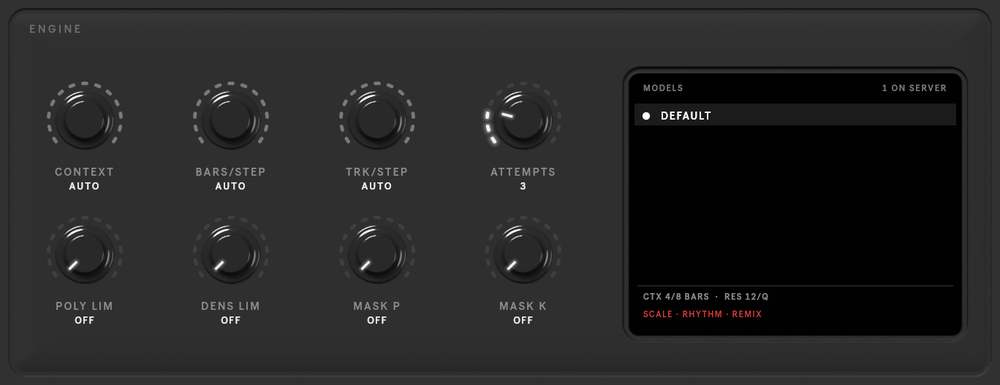

# ENGINE

The **ENGINE** key at the top right opens the model and how it generates. These settings are for the whole device.

| Control | Range (default) | What it does |
|---|---|---|
| **Models** | the server's list | which model to use, when the server offers several |
| **GENRE** | NONE, or the model's genres | prism and expressive: the style to write in; the **GENRE** tab over the model list opens the list (scroll with the wheel) |
| **CONTEXT** | the model's options (AUTO) | how many bars the model sees at once |
| **BARS/STEP** | 1 to CONTEXT (AUTO) | how many bars are generated per step |
| **TRK/STEP** | 1–16 (AUTO) | how many tracks are generated per step |
| **ATTEMPTS** | 1–10 (3) | how many times a rejected result is retried |
| **POLY LIM** | 0–32 (off) | a hard limit on notes sounding at once |
| **DENS LIM** | 0–64 (off) | a hard limit on notes per bar |
| **MASK P** | 0–0.95 (off) | hide this share of the context from the model, for more freedom |
| **MASK K** | 0–100 (off) | the same, as a number of tokens |
| **VELOCITY** · **MICRO** | on / off | generate velocities and microtiming, when the model supports them |

Long scenes are generated in steps: the model writes **BARS/STEP** bars of **TRK/STEP** tracks at a time, sliding its
**CONTEXT** window along the scene.

<video src="../assets/video/engine.mp4" poster="../assets/video/engine.jpg" autoplay muted loop playsinline></video>
