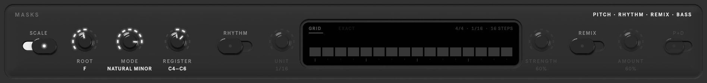

# MASKS

Masks constrain what the selected track may play. Like the [TRACK](track.md) controls, they are stored per track.

## Pitch

| Control | What it does |
|---|---|
| **SCALE** | only notes in the scale |
| **ROOT** · **MODE** | the key: root note and scale (major, natural minor, modes, pentatonics, harmonic and melodic minor…) |
| **REGISTER** | the lowest and highest note allowed (only with SCALE on) |

## Rhythm

| Control | What it does |
|---|---|
| **RHYTHM** | guide where notes start |
| **GRID** | onsets lean toward a grid of **UNIT** steps, as much as **STRENGTH** says |
| **EXACT** | notes start only on the steps you draw: click a step to toggle it, Shift-click for its accent |

The screen shows the bar's steps for the scene's time signature.

## Remix

| Control | What it does |
|---|---|
| **REMIX** | vary the existing notes instead of writing new ones: keep the rhythm, change the notes |
| **AMOUNT** | how much to change |
| **P+D** | change pitch and duration (off: pitch only) |

Remix replaces the rhythm settings on the same track.

<video src="../assets/video/masks.mp4" poster="../assets/video/masks.jpg" autoplay muted loop playsinline></video>

!!! note
    Which masks a model supports depends on the model: unsupported ones are dimmed.
