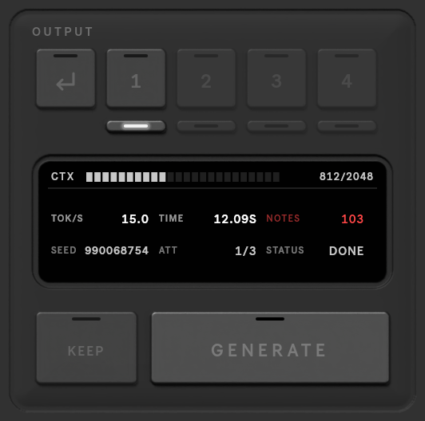

# OUTPUT and takes

## Generate

**GENERATE** sends the scene to the server. While it runs, the key reads **CANCEL**, and the stats screen counts
the notes as they arrive. A finished generation is written straight into the target clips, so you hear it at once.

## Takes

With **TAKES** above 1, one request returns several versions. The keys show them, four at a time (the thin keys
under them switch groups):

| Key | |
|---|---|
| **1**, **2**, … | write that take into the clips; switch any time, even while the music plays |
| **↩** | go back to what was there before |
| **KEEP** | commit the take you are on |

Only the generated bars are rewritten; the rest of each clip is untouched.

<video src="../assets/video/takes.mp4" poster="../assets/video/takes.jpg" autoplay muted loop playsinline></video>

## The stats screen

| | |
|---|---|
| **CTX** | how much of the model's context window the request uses |
| **TOK/S** | generation speed, in tokens per second |
| **TIME** | how long it took |
| **NOTES** | notes written into the targets |
| **SEED** | the seed it used |
| **ATT** | the attempt that was accepted, out of **ATTEMPTS** (single generations) |
| **STATUS** | READY, RUNNING, DONE, STOPPING, CANCEL or ERROR |

A single generation streams: NOTES, TOK/S, CTX and ATT update while it runs. A batch of takes reports when it is
done.

When a request fails, the screen shows what went wrong and what to change; click it to clear.

<video src="../assets/video/stats.mp4" poster="../assets/video/stats.jpg" autoplay muted loop playsinline></video>
