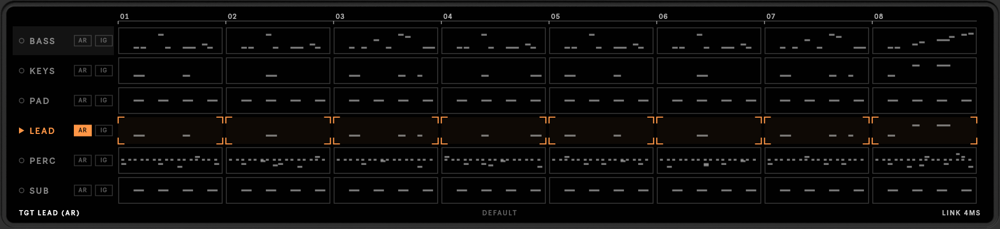

# Choosing what to write

The roll at the top of the window shows every MIDI track in the selected scene, bar by bar, with the notes of its
clip. Everything you generate is chosen here.

## Targets and context

A track is a **target** when you paint some of its bars or turn on its **AR** button. Every other track is
**context**: MIDI-GPT reads it to fit the new notes to the music, and leaves it untouched. The line under the roll
lists the current targets (`TGT LEAD (AR)`), or says **PAINT BARS** when there are none.

| Do this | To |
|---|---|
| Click or drag across bars | paint them for rewriting (orange brackets). Drag again from a painted bar to unpaint. |
| **AR** | write the whole track (autoregressive), including a track with no clip in this scene yet; it then gets one |
| Click a bar of an **AR** track | start writing there: the bars before it are kept as the track's own history (an orange notch marks the start). Click it again to start from bar 1 |
| **IG** | ignore the track: it is neither written nor used as context |
| A name struck through in amber | the server left that track out of the context so every step fit (see [Engine](engine.md)); it shows until the next run |
| Click a track name | select it, for the [TRACK](track.md) and [MASKS](masks.md) controls |

Painting bars on an ignored track switches it off; on an **AR** track a click sets where it starts. To paint bars on
an AR track, turn **AR** off first.

!!! note "Scenes"
    MIDI-GPT works on the selected scene. All its clips must share one time signature, and the scene needs at least
    **CONTEXT** bars (see [Engine](engine.md)). The clips' loop lengths set how many bars the roll shows.

## Rewrite a few bars, or a whole track

- **Infill** keeps everything around the painted bars, so the new notes join the existing part at both ends: good for
  fixing a bar or varying the end of a phrase.
- **AR** writes the track from its start, or from the bar you click: continue a part from bar 9 and keep bars 1–8
  as they are. Use it for a new part, an ending, or to replace one completely.

<video src="../assets/video/rewrite.mp4" poster="../assets/video/rewrite.jpg" autoplay muted loop playsinline></video>
