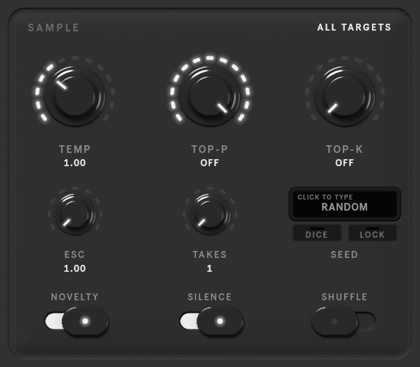

# SAMPLE

How the model samples, for the whole request.

| Control | Range (default) | What it does |
|---|---|---|
| **TEMP** | 0.1–3 (1) | randomness: lower is safer and more repetitive, higher is more adventurous |
| **TOP-P** | 0.05–1 (off) | sample only from the most likely choices that add up to this probability |
| **TOP-K** | 0–500 (off) | sample only from the K most likely choices |
| **ESC** | 1–3 (1) | raise the temperature on each retry after a rejected result |
| **TAKES** | 1–16 (1) | how many versions to generate in one request (see [Takes](output.md)) |
| **NOVELTY** | on / off | reject a result that copies the context |
| **SILENCE** | on / off | reject a result with empty bars |
| **SHUFFLE** | on / off | vary the order in which the targets are generated |

A rejected result is retried, up to **ATTEMPTS** times (see [Engine](engine.md)).

## Seed

The seed screen shows which random seed the next generation uses.

| | |
|---|---|
| **RANDOM** | a new seed every time (the default) |
| Click the screen | type a seed: digits only, 1 to 2147483647. Enter sets it; an empty field or 0 goes back to random. |
| **DICE** | pick a random seed and keep it |
| **LOCK** | keep the seed you just heard: the last run's, or with takes, the selected take's. Click again for random. |

The label above the number says where the seed came from: **LAST RUN**, **TAKE 3**, **TYPED** or **DICE**. A fixed
seed with the same settings and context gives the same result again.
