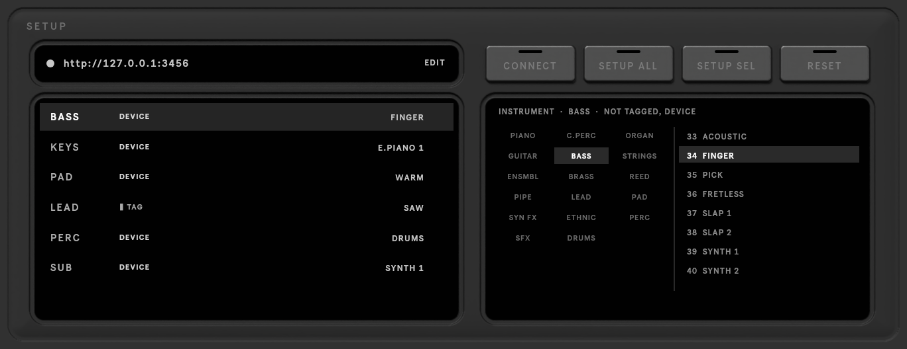

# SETUP

The **SETUP** key at the top right opens the server address and each track's instrument.

## Server

The address of the MIDI-GPT server. The light is green when the server answers. Click **EDIT** to change it:
`http://127.0.0.1:3456` for the server on this computer, or another machine's address (see
[Install](../install.md#the-server-on-another-computer)). The address is remembered for every set.

## Track instruments

MIDI-GPT needs to know what each track plays: one of the 128 General MIDI instruments, or drums. The list shows each
track, where its instrument came from, and the instrument.

| Key | |
|---|---|
| **SETUP ALL** | go through every track: guess each instrument, confirm it (or pick another), and tag the track |
| **SETUP SEL** | the same for the selected track, or for the rows you Shift-clicked |
| **CONNECT** | check the server again and reload its models |
| **RESET** | put every setting back to its default (the server address stays); click again when it reads **SURE?** |

Pick an instrument for the selected track in the browser on the right: a family, then a program.

The instrument is stored on the track itself, in a small **MIDI-GPT Instrument** device that setup adds. It follows
the track when you rename, move or duplicate it, and is saved with the set. You can also change it from that device's
**FAMILY** and **PROGRAM** menus.

A track without a tag is guessed from its instrument (a Drum Rack means drums), then from its name, else piano.

!!! note
    MIDI-GPT doesn't play anything: your tracks keep their own instruments and sounds.

<video src="../assets/video/setup.mp4" poster="../assets/video/setup.jpg" autoplay muted loop playsinline></video>
