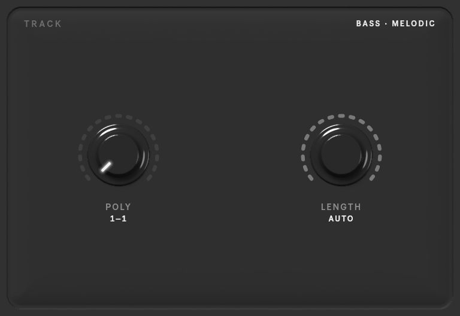

# TRACK

Controls for the selected track. They are stored per track, so each target can ask for something different. The
bay shows only the controls that apply to the track: melodic tracks get **POLY** and **LENGTH**, drum tracks get
**DENSITY**.

| Control | Range | What it does |
|---|---|---|
| **POLY** | 1–10, or AUTO | how many notes sound at once, as a range: 1–1 for a monophonic line |
| **LENGTH** | 32nd to whole notes, or AUTO | the range of note lengths |
| **DENSITY** | 1–10, or AUTO | how busy the part is (drum tracks) |

Prism and expressive models add a second row:

| Control | Range | What it does |
|---|---|---|
| **KEY** | the 24 keys, or AUTO | the key the part is in (melodic tracks) |
| **RANGE** | 1–48 semitones, or AUTO | how wide the part's pitch range is (melodic tracks) |
| **SILENCE** | 0–90 %, or AUTO | how much of each bar is silent |
| **PCS** | 1–12, or AUTO | how many different pitch classes each bar uses (melodic tracks) |
| **EXPRESSIVENESS** | GRID, 1–11, FREE, or AUTO | expressive only: how loosely the notes sit on the beat, from on the grid to freely timed |

**AUTO** leaves the choice to the model, reading it from the context.

## Using the knobs

- **Drag** up or down to turn a knob; hold **Shift** for fine steps.
- **Double-click** switches AUTO on or off, or resets a knob to its default.
- Range knobs (POLY, LENGTH) have two pointers: a drag moves the nearer one. Hold **Option** to move the whole
  range.

!!! note
    Density is only available for drum tracks with the current models; the server refuses it on melodic tracks.
