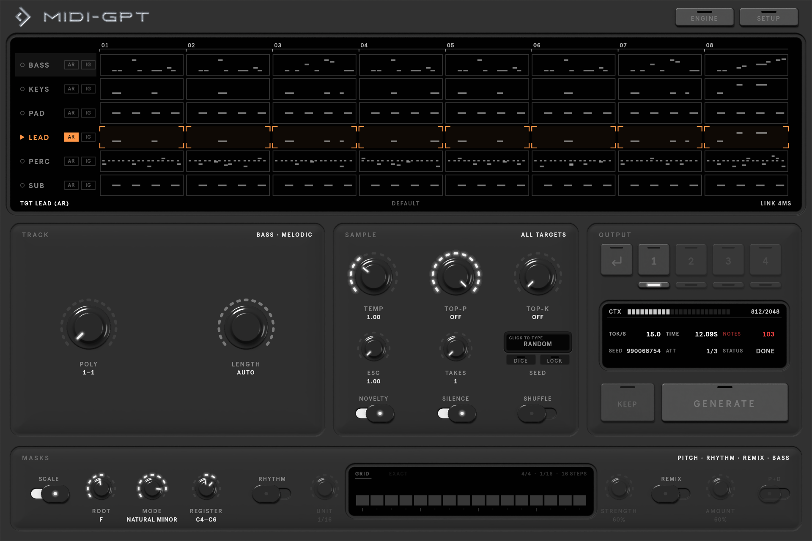

# MIDI-GPT for Live

<video class="hero" src="assets/video/trailer_short.mp4" poster="assets/video/trailer_short.jpg" autoplay muted loop playsinline controls></video>

**A multitrack MIDI generation machine for Ableton Live.** MIDI-GPT for Live is a free, open-source Max for Live
device that writes MIDI into your clips with [MIDI-GPT](https://github.com/Metacreation-Lab/MIDI-GPT), a transformer
for computer-assisted multitrack composition. It reads every MIDI clip in the selected scene as context, generates
the bars you choose, and writes the result back as takes you can audition, revert or keep.

[Install](install.md){ .md-button .md-button--primary } [Quick start](quickstart.md){ .md-button }

- **Fill in bars.** Paint the bars to rewrite on any track. The rest of the scene stays as it is and is used as
  context.
- **Continue or create tracks.** Turn on **AR** to write a whole track, including one that has no clip yet.
- **Steer the output.** Polyphony, note length, density, scale, register, rhythm and remix per track; temperature,
  top-p, top-k and seed for the whole request.
- **Takes.** Generate up to 16 versions at once, switch between them while the music plays, go back to the original,
  or keep one.
- **Runs on your computer.** The model runs in a local server, with no GPU needed. Nothing leaves your machine
  unless you point the device at a server elsewhere.

## Requirements

| | |
|---|---|
| **Ableton Live** | 11 or 12: Suite, or Standard with the Max for Live add-on |
| **Max** | the Max bundled with Live: 8.6 (Live 11 to 12.1) or 9 (Live 12.2 and later) |
| **System** | macOS. The installer also runs on Linux; on Windows, install by hand. |
| **Server** | Python 3.10–3.12 and `midigpt` 0.3.4, which the installer sets up |
| **Disk** | about 1 GB for the server, plus the model: 83 MB (`yellow_small`) or 350 MB (`yellow_medium`) |

## Watch the full trailer

The 1:40 tour of every feature: [full trailer](https://github.com/Metacreation-Lab/midigpt-LIVE/releases/latest).

MIDI-GPT for Live is made by the [Metacreation Lab for Creative AI](https://metacreation.net) at Simon Fraser
University. Its companion is [MIDI-GPT for REAPER](https://github.com/Metacreation-Lab/midigpt-REAPER).
